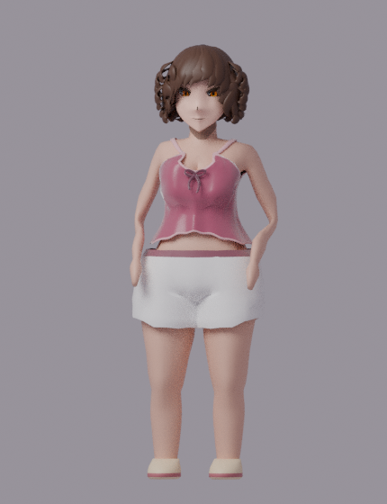

# Rosé 1.2.1 · Mecânica corporal
No editor Godot para Android, extraia o ZIP em uma pasta nova, importe o arquivo project.godot e execute o projeto. A cena inicial é mechanics_lab.tscn. A cena mobile_lab.tscn continua disponível para comparar a versão anterior. Godot 4.7.2 foi a versão usada nos testes.

## Experimente primeiro a mão
Escolha **Mão direita**. Toque na mão visível de Rosé e levante o dedo. O rótulo **Agarrar · Mão** indica que ela está ao alcance. Toque em **Agarrar** e espere **Ligado**. Arraste um pouco para o lado, pare e observe o cotovelo, o tronco e a cabeça. Depois toque em **Soltar**. O controle de profundidade fica na lateral. No PC, aponte e clique para pegar, mova o mouse e clique novamente para soltar. Para separar alvos sobrepostos em tela, use o botão Câmera e orbite antes de agarrar.

Em **Duas independentes**, o toque iniciado à direita controla D e o toque à esquerda controla E. Mire um alvo e agarre com cada mão. O botão **D / E** muda a mão ativa para soltar somente um vínculo. Em **Par espelhado**, um dedo movimenta ambas. O modo **Câmera** reserva arrasto e pinça para a vista. No pirulito, o modo original mantém oferecer/retirar. Nos modos de mão, o próprio pirulito pode acompanhar a palma.

Para tirar a camisola, mire a peça perto da cintura, ligeiramente à direita do centro na vista frontal. Para o short, mire a região superior à esquerda do centro. Confirme o nome da peça, toque em **Agarrar**, arraste para ver a tração e toque em **Remover**. **Recolocar** restaura primeiro a última peça retirada. Cada peça é um conjunto de malhas com uma deformação de tração. A retirada alterna a visibilidade do conjunto. Não há simulação de tecido desvestindo o corpo.

## Por que o punho escapava
O rig anterior tinha pivôs fora da superfície e a regra de pesos por altura deixava vértices das mãos ligados à base. Medidos no espaço glTF do lado direito, os pivôs anteriores do punho eram aproximadamente (0,695; 1,310; 0,018) m. O novo punho fica em (0,568; 1,072; −0,080) m. Um teste das coordenadas dos ossos conseguia passar mesmo quando a pele ficava para trás. A primeira inspeção visual mostrou esse defeito. Recalibramos os dois braços, as matrizes inversas de bind e as transições de pesos no corpo.

O solver antigo restaurava o bind a cada passo e, em repouso, deixava o braço na posição de referência. A resposta ainda dirigia formas corretivas de braço junto com o IK. Agora a cena resolve uma postura ociosa em cada passo e atribui a rotação dos braços a um único solver. O GLB anterior não tinha clipe ocioso exportado. Esta cena não usa AnimationTree para os braços.

A seleção antiga comparava a distância 3D da palma a dois punhos e ao pirulito. Parecer perto na tela era insuficiente. Agora o seletor considera distância no mundo e distância projetada. Ao confirmar, ele ajusta a profundidade e conserva o deslocamento inicial do alvo. As zonas de braço acompanham o esqueleto. Duas mãos podem prender pontos diferentes. Vínculos são restrições procedurais de alcance e molas, sem juntas de ragdoll. Força indicada é uma intensidade de 0 a 1.

## Editar e entender o sistema
| Arquivo | Onde mexer e o que observar |
|---|---|
| mechanics/posture.gd | Em solve(), idle define o alvo de cada punho em relação ao ombro. Aumente um pouco a componente Z para trazer as mãos para frente. IDLE_DROP abaixa o alvo. clock modula respiração e oscilação. O deslocamento de Base e a inclinação de Spine definem o apoio em repouso. |
| mechanics/posture.gd | low/high limitam a abertura usando comprimentos reais e flexão de 15° a 120°. pole orienta o cotovelo. MAX_PULL limita a solicitação. Mude um parâmetro de cada vez e teste também a vista lateral. |
| mechanics/body_lab.gd | Em sync_anchors(), crie uma âncora com nome e coordenada. Para o braço, interpole entre dois ossos com lerp. Em toggle_grip(), associe ao braço apenas alvos que devam dirigir o punho. follow_held() distribui tração entre braço e tronco e integra a mola. |
| mechanics/moving_contact.gd e precision/hand.gd | Cada zona possui centro e três raios em metros. sample mede contato local; sweep testa o segmento percorrido pela mão. Crie uma zona e atualize seu centro em sync_anchors se ela se move. As formas são aproximações. |
| mechanics/body_lab.gd | CLOTHES lista as malhas por peça. Para adicionar outra, crie a âncora, registre as malhas e atualize a associação de fabric_pull à peça em follow_held(). O pirulito mostra como atualizar um objeto de fato durante o vínculo. |
| mobile/touch_lab.gd | start_finger atribui cada dedo a um controle. move_hand e hand_world convertem posição e profundidade em alvo. follow_held é substituído pela cena nova. |
| mechanics_lab.tscn, project.godot, assets/rig121.glb | Cena, ponto de entrada e novo modelo. rig11.glb continua disponível. tests/mechanics_test.gd cobre a nova cena. |

**Exercício 1.** No Android, abra **Diagnóstico**, agarre uma mão e repita o mesmo arrasto com duas regulagens. Rigidez aumenta a rapidez com que o corpo acompanha a tração. Amortecimento maior reduz o balanço. Recuperação altera a rapidez depois de soltar. Observe os valores de cada mão e o indicador de limite dos cotovelos. Ajustes do painel valem para a sessão.

**Exercício 2.** No painel FileSystem, abra mechanics/posture.gd no editor de scripts. Altere IDLE_DROP em 0,02 m, salve e execute. Compare a altura das mãos e o ângulo do cotovelo em repouso. Para alterar a respiração sem alterar a frequência de oscilação dos braços, edite apenas a senoide do Spine. Para transformar o repouso em um clipe, use uma cópia da cena e faça o solver ler a pose amostrada pelo AnimationPlayer antes do passe de IK. O reset atual descarta animação óssea externa.

**Exercício 3.** Adicione uma âncora no meio do braço interpolando ombro e cotovelo. Teste se o rótulo aparece dos dois lados ao orbitar e se a seleção ainda distingue a camisola. Depois altere o fator de transferência em follow_held e compare a inclinação do tronco.

**No Blender.** Importe assets/rig121.glb em um arquivo novo. Em Edit Mode, mostre o esqueleto à frente e confira Upper, Fore e Palm de ambos os lados em vistas frontal e lateral. Em Pose Mode, gire cada Fore e confira os vértices do punho em Weight Paint. Os dedos devem acompanhar Palm, o ombro deve ter transição suave entre Spine e Upper. Normalize os pesos ao editar. Em Object Data Properties da malha, varie as shape keys idle_knees e fabric_pull de 0 a 1. A primeira representa flexão discreta de repouso. A segunda existe nas peças preparadas. Para editar, duplique o GLB, exporte preservando skin, nomes e morph targets e aponte uma cópia da cena para ele. Para regenerar o GLB entregue, execute na pasta do projeto com Python 3 e NumPy: `python mechanics/build_knees.py assets/rig11.glb assets/rig121.glb`. O script usa mechanics/rebind.py. Nenhuma alteração no .blend artístico é necessária para rodar esta versão.

## Roteiro de aprovação no Android
| Prova | Como decidir |
|---|---|
| Repouso por 20 segundos, frente e perfil | Braços baixos, cotovelos sem inversão, cabeça e tronco oscilando discretamente. Inspecione se a roupa atravessa a pele. |
| Encostar e afastar lentamente do ombro | O estado de contato muda e a região volta em repouso sem ficar presa. |
| Agarrar o punho e puxar devagar, depois rápido | Confirme o nome, o vínculo e a intensidade. Compare braço, tronco e cabeça. Pare no limite e solte. Reprove se a mão visível se separar de forma persistente do punho ou o cotovelo virar. |
| Dois alvos | Prenda punho e ombro opostos. Mova em sentidos contrários, solte apenas uma mão e depois a outra. Confira recuperação sem salto persistente. |
| Cabeça, tronco, quadril e pernas | Confira o alvo e a reação do conjunto. Pernas não têm IK individual ou passos de compensação. |
| Peças e objeto | Puxe cada peça, remova, recoloque. Pegue o pirulito em modo mão. Alterne câmera, zoom e mãos, também em retrato. |
| Interrupção | Saia para outro aplicativo, volte e reinicie a cena. Confira vínculos liberados e ausência de arrastos fantasmas. |

## Validação registrada
Cinco scripts passaram em Godot 4.7.2 headless: interaction_test, dynamic_test, precision_test, mobile_touch_test e mechanics_test. O último testa repouso, aquisição por toque sintético e botão, condução, dois vínculos, movimentos lentos/rápidos, limites, liberação, recuperação, clique, pirulito e roupas. A imagem acima é uma reconstrução no Blender de um quadro de repouso usando as matrizes ósseas computadas na Godot. A interface gráfica da Godot e um Android físico não foram testados aqui. Latência ao toque, sensação de peso, iluminação no aparelho e estabilidade visual durante toda a amplitude ainda precisam do roteiro acima. O rig tem nove ossos, sem clavículas ou pernas articuladas; os pés não executam passos. Seleção por proximidade projetada pode escolher um alvo sobreposto. O sistema atende pontos cadastrados; não permite agarrar cada triângulo nem oferece física de tecido livre.
