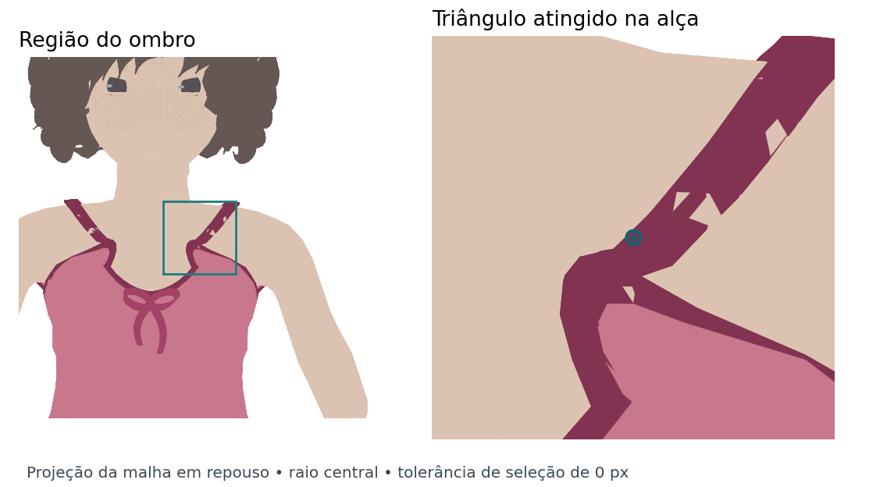

# Rosé 1.2.2 · Toque direto no Android

Extraia o ZIP em uma pasta nova, importe project.godot e execute o projeto. A cena inicial é direct_touch.tscn. Para comparar com a versão anterior, abra mechanics_lab.tscn e execute apenas essa cena.

## Primeiro teste: a alça

Escolha **Câmera**, aproxime com uma pinça e volte ao modo de mãos. Toque na parte visível da alça e mantenha o dedo parado por 0,36 s. A ponta do indicador virtual marca o contato. Espere **Vinculado** antes de arrastar. Levante o dedo para soltar. Um toque curto só posiciona a mão. O limite de movimento antes do vínculo é ajustável em **Precisão do gesto**. Na camisola, a tração ainda usa a forma de deformação da peça inteira. Para observar uma alça dobrando localmente, abra **Tecidos**.

A figura mostra uma projeção da geometria amostrada em repouso. O círculo indica uma interseção obtida com a tolerância de seleção em zero.

| Controle | Resultado |
|---|---|
| Duas independentes | Cada dedo conserva seu vínculo até ser solto. Comece em lados opostos para facilitar a identificação. |
| Par espelhado | Um dedo move as mãos em sentidos horizontais opostos. O segundo vínculo depende de uma superfície alcançada pelo raio correspondente. |
| Câmera | Um dedo orbita e a pinça aproxima. A troca de ferramenta encerra o gesto ativo. |
| Ajustes | Altere duração, sensibilidade, tolerância, rigidez, elasticidade, amortecimento, força máxima, recuperação e suavização. Desative **Indicadores de contato** para ocultar os rótulos. **Salvar perfil** grava as escolhas em user://rose_touch_122.cfg. |
| Tecidos | Abre a bancada com amostra, tira e alça de bolsa. Toque, mantenha, puxe e solte. **Rosé** retorna à cena principal. |

## Do pixel ao triângulo

A versão 1.2.1 comparava a posição do cursor e da mão a centros de regiões. Um único centro representava a camisola. Isso explicava a dificuldade de selecionar a alça e os erros de profundidade quando havia superfícies sobrepostas.

Em direct/surface_picker.gd, configure registra as malhas do modelo e do pirulito. A câmera fornece a origem do raio com project_ray_origin e a direção com project_ray_normal. cast descarta grupos de triângulos cujas caixas não cruzam o raio. Nos restantes, vertex aplica os blend shapes e os pesos do esqueleto antes da interseção. O menor percurso positivo escolhe a superfície visível mais próxima. Peças ocultas ficam fora da consulta. O cálculo usa uma tolerância numérica relativa à área dos triângulos, importante para o cabo do pirulito.

O raio central tem prioridade. Se errar, a tolerância opcional experimenta oito raios vizinhos em ordem fixa. Ajuste **Tolerância** para zero ao medir precisão. A compensação do deslocamento inicial preserva o ponto escolhido ao começar a arrastar. As caixas são filtros de busca. A decisão final usa os triângulos; camadas e máscaras do mundo físico não participam dessa seleção.

O vínculo guarda o triângulo e três pesos baricêntricos, que especificam o ponto dentro dele. A cada passo, track recalcula os três vértices deformados. place_hand usa a normal e a tangente para orientar a mão e alinha a ponta do indicador pouco acima do contato. O arrasto usa um plano paralelo à tela que passa pelo ponto inicial. A amplitude é limitada e a suavização filtra mudanças rápidas. A mola e o IK da 1.2.1 continuam conduzindo a postura. O indicador de resistência expressa a intensidade normalizada da tração.

## Editar no Godot e no Blender

1. Pelo FileSystem do editor Android, abra direct/preferences.gd. Em SPECS, cada linha contém mínimo, máximo, passo e padrão. Para experimentar sem editar código, use **Ajustes**. Salve o perfil, volte à outra cena e confira se ela carrega os mesmos valores.
2. Para adicionar um acessório rígido, inclua seu MeshInstance3D na lista de objetos de picker.configure, em direct/direct_lab.gd. Dê um nome à peça em label_for e defina em start_link e follow_held o que acompanha o arrasto. Use o pirulito como exemplo. Geometria de seleção, identificação e resposta são três etapas distintas.
3. No Blender, confira a superfície de frente e de perfil. Aplique a escala antes de vincular o rig, verifique normais e pesos e exporte uma cópia GLB com skin e morph targets. Para uma tira estreita, mantenha largura real na malha. Transparência pintada sobre um plano inteiro deixa o plano inteiro selecionável. Reimporte e repita o teste com tolerância zero. O seletor atual lê até quatro influências ósseas por vértice.
4. Para colisão de jogo independente do toque, configure no Godot um CollisionShape3D sob o corpo físico e confira suas camadas e máscaras contra as do objeto que encosta. Use cápsulas para membros ou formas convexas para acessórios móveis. Compare visualmente o contorno em perfil. A etapa de seleção direta continua usando a malha visível mesmo quando o colisor físico é simplificado.

## Laboratório de tecidos

Em direct/fabric.gd, sample_grid cria partículas, triângulos, pontos fixos e restrições de distância. As ligações diagonais resistem ao cisalhamento; as de dois segmentos resistem à dobra. simulate integra a velocidade implícita pelo deslocamento desde o passo anterior e corrige distâncias em quatro iterações. A tração é distribuída pelos vértices do triângulo tocado. Uma esfera e um piso limitam a penetração. O amortecimento dissipa movimento e a recuperação atrai a rede para a forma de repouso.

| Técnica | Aplicação nesta versão | Limite |
|---|---|---|
| Rede física de partículas | Três amostras da bancada, com dobras e colisão local | Sem autocolisão ou contato entre as três amostras. |
| Resposta procedural | Molas do corpo e IK dos braços | A reação depende do rig e dos limites definidos. |
| Blend shape | Tração da roupa vestida | Forma prevista pelo artista; puxar a alça ainda afeta uma área maior da camisola. |

**Exercícios.** Primeiro compare uma puxada idêntica com dois valores de amortecimento e observe o retorno. Depois, em uma cópia do projeto, mude os pinos da amostra de tecido de dois para três e observe onde a dobra se forma. Por fim, acrescente uma quarta tira em sample_grid, reposicione a câmera para enquadrá-la e tente selecioná-la dos dois lados da esfera.

## Aprovação manual no Android

| Prova | Critério |
|---|---|
| Alça frontal e em três quartos, tolerância zero | A ponta do indicador acompanha a superfície sob o dedo. Um toque no espaço ao lado deve errar. Faça zoom para distinguir alça e ombro. |
| Punho, antebraço, ombro e pirulito | Compare toque curto e longo. Só o longo mantém vínculo ao arrastar. Confira alvos pequenos também de perfil. |
| Arrastos lentos e rápidos | Acelere, pare e solte. Observe tremor, penetração dos dedos e retorno do corpo; repita com os indicadores ocultos. |
| Duas mãos e modo espelhado | Solte um dedo enquanto o outro continua conduzindo. No espelho, compare o deslocamento das mãos quando ambos os lados têm superfície. |
| Câmera, interrupção e ajustes | Orbite e faça pinça sem agarrar. Troque de aplicativo durante um arrasto. Confira soltura, ausência de vínculo residual e persistência do perfil salvo. |
| Bancada | Puxe o centro da amostra, a tira junto à esfera e a alça junto a um pino. Observe a diferença de resistência e confira se os pontos fixos permanecem no lugar. |

**Registro de validação.** O teste tests/direct_touch_test.gd usa eventos sintéticos no viewport, mede reprojeção do raio e posição do indicador, testa três ângulos, dois vínculos, espelho, liberação e recuperação. Também verifica a seleção de um triângulo superior da camisola e a resposta das três amostras. Os testes herdados estão em tests/. Os arquivos principais novos são direct_touch.tscn e os scripts e cena em direct/. project.godot seleciona a nova cena, e precision/hand.gd aceita amostras diretas de contato. A experiência tátil, a taxa de quadros no celular e a aparência em movimento ainda precisam da aprovação manual em dispositivo físico. Materiais transparentes e deformações exclusivas de shader podem divergir da superfície geométrica.
