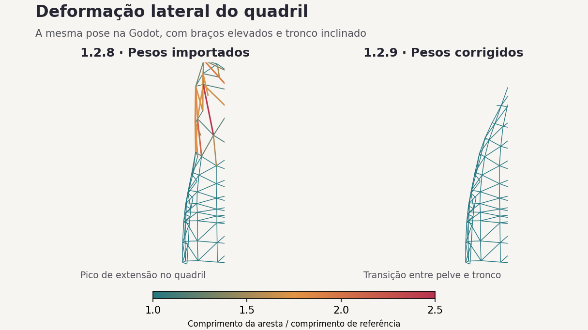
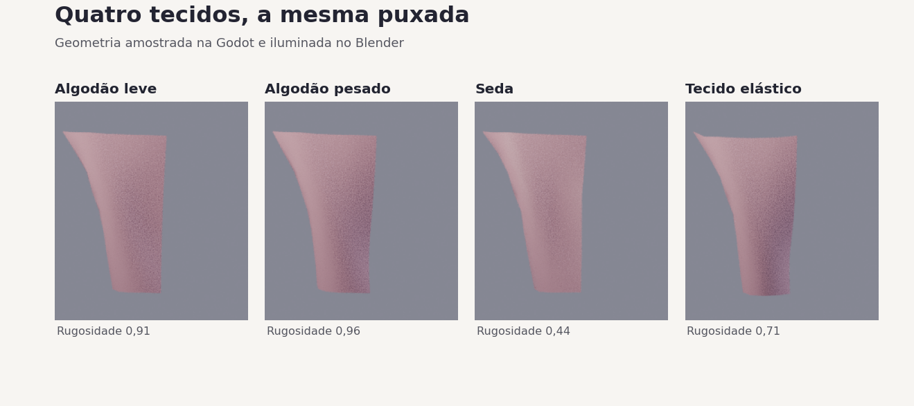

# ROSE 1.2.9 · Integridade da malha e qualidade do tecido

PC e Android usam o mesmo ZIP. Importe `project.godot` e execute pelo Godot. A janela identifica a 1.2.9. Use **Tecidos** na cena principal para abrir a bancada, depois toque no botão com o nome do tecido para trocar ou editar seu perfil. Os quatro materiais usam a mesma amostra e os mesmos controles.

## O que causava as pontas no quadril

Na malha importada em pose de referência, a geometria lateral manteve suas dimensões. Com os braços elevados, uma aresta lateral aumentou de **4,81 cm para 12,12 cm** no primeiro ensaio isolado. Os vértices daquele trecho tinham cerca de **3,6% e 15,1%** de peso em `UpperL`. O osso do braço puxava o quadril de forma desigual. Desligar as blend shapes não eliminou o pico. Com as blend shapes ativadas e os ossos na pose de referência, o maior alongamento isolado ficou perto de 10%. O teste da revisão encontrou o problema na distribuição de pesos do GLB, que o IK tornava visível durante a pose.

A correção acontece na Godot em `mechanics/hip_skin.gd`. Ao importar a cena principal, ela duplica a malha em memória, remove gradualmente a influência dos braços do quadril e redistribui o peso para a pelve e o tronco. A posição das mãos e dos antebraços no bind foi considerada para evitar cortar sua influência. O GLB original, a topologia, os morphs e os arquivos Blender permaneceram intactos. O seletor de toque usa a mesma malha corrigida que a renderização.

| Cenário controlado | Maior aresta na 1.2.8 | Maior aresta na 1.2.9 |
|---|---:|---:|
| Repouso | 1,13× | 1,02× |
| Braços elevados e inclinação | 2,57× | 1,08× |
| Rotação de tronco aplicada ao esqueleto | 2,60× | 1,11× |
| Flexão visual dos joelhos e morphs | 2,63× | 1,09× |
| Recuperação | 1,14× | 1,02× |

A medida é comprimento deformado dividido pelo comprimento de referência. A área medida na amostra do quadril ficou entre 98,7% e 99,4% da original na 1.2.9. Isso é uma medida de superfície, não de volume anatômico. A flexão dos joelhos existente usa a blend shape `idle_knees`. O modelo ainda não tem um rig completo de pernas.

### Reproduza o diagnóstico no Blender e na Godot

1. Abra uma cópia do modelo de trabalho. Se quiser comparar exatamente o que o jogo recebe, importe `assets/rig121.glb` em um Blender vazio. Em Pose Mode, levante `UpperL` e `UpperR` e observe a lateral do quadril em três quartos.
2. Em Weight Paint, ative o grupo do braço, selecione vértices na lateral e use o painel de pesos do vértice para examinar seus grupos. Repita com o grupo da pelve. Um vértice do quadril recebendo peso do braço indica a causa mesmo quando a pose de referência parece correta. Corrija no arquivo autoral apenas se quiser aplicar os mesmos pesos na exportação de origem. Confira a transição para a axila, preserve o antebraço e normalize os pesos antes de exportar.
3. Na Godot, rode a mesma pose com os pesos das blend shapes primeiro zerados. Depois, fixe os ossos no bind e reative um morph por vez. Compare com o esqueleto em movimento. No projeto atual, o solver repõe a pose de referência antes de aplicar o IK a cada passo. Isso permite isolar pesos incorretos de acumulação de rotação.
4. Execute `godot --headless --path /caminho/do/projeto -s res://tests/mesh_integrity_test.gd` para medir as arestas da amostra na mesma pose.

## O que mudou no tecido

A bancada agora deriva a massa de cada partícula da área dos triângulos vizinhos e da gramatura. Usa restrições por passo para alongamento e flexão, com enrijecimento quando a extensão passa do intervalo esperado. A pega tem deslocamento limitado para evitar que um dedo estique indefinidamente um triângulo perto do pino. A gravidade afeta a queda e o atrito dissipa deslizamento junto à esfera e ao piso. A amostra conserva os pinos e continua dobrando após a soltura. Uma alça ou tira que encosta no apoio pode repousar em outra dobra estável.

| Perfil | Gramatura | Rugosidade | Pico de alongamento na mesma puxada |
|---|---:|---:|---:|
| Algodão leve | 130 g/m² | 0,91 | 21,1% |
| Algodão pesado | 265 g/m² | 0,96 | 16,0% |
| Seda | 65 g/m² | 0,44 | 26,6% |
| Tecido elástico | 175 g/m² | 0,71 | 33,4% |

Na 1.2.8, o mesmo ensaio de arraste na amostra chegou a 56,6%. São extremos locais medidos sob a carga do teste, sem calibração para um tecido comercial. A seda recebeu maior complacência à flexão e menor atrito. O algodão pesado mantém vincos mais largos, e o elástico cede mais sob a pega. **Complacência maior** facilita a deformação. O controle de **extensão antes do enrijecimento** define a faixa em que o tecido começa a resistir mais. **Amortecimento** dissipa movimento no ar. **Atrito** reduz deslizamento no contato. **Gravidade** controla a intensidade da queda. O solver ainda não calcula autocolisão.

A roupa importada usava rugosidade de 0,32 na superfície principal da camisola, e o laço usava 0,34. A roupa da cena principal passou para o acabamento de algodão leve, com rugosidade 0,91 e especular 0,13. O material usa luz difusa, e a camisola mantém o acabamento durante a retirada e a queda. Na bancada, as normais são reconstruídas pelas faces deformadas, o que permite ver a iluminação acompanhar as dobras. Os quatro perfis atuam na bancada. A mecânica de retirada da 1.2.8 continua usando seu solver próprio.

### Editar e salvar

- **Pelo touchscreen** · No botão com o nome do tecido, escolha o perfil e ajuste os controles. **Salvar tecidos** guarda as edições de cada perfil e a seleção atual no dispositivo.
- **Pelo Inspector** · Abra um recurso em `direct/fabrics/` ou selecione **Fabric Profiles** no nó de `direct/fabric.tscn`. Edite e salve os recursos `.tres`. Se o jogo já tiver valores locais salvos, use **Restaurar valores do Inspector** e **Salvar tecidos** para adotar os novos padrões.
- **No Blender** · Edite a topologia, as normais de base e o weight painting do modelo autoral. Na Godot ficam o ajuste de materiais do jogo, a correção de carregamento e os parâmetros de simulação.

## Roteiro no Android

1. Enquadre o quadril de três quartos. Pegue as mãos, puxe de lado e solte. Depois eleve os braços pelo gesto existente da alça e observe a recuperação. Compare com a 1.2.8 sob a mesma configuração.
2. Abra **Tecidos**. Puxe no meio da mesma amostra com cada perfil. Alterne entre algodão leve e elástico para comparar a tensão. Compare algodão pesado e seda ao soltar.
3. Puxe a tira junto à esfera e observe a dobra e o deslizamento. Salve um ajuste de seda, mude de perfil e volte para verificar se a edição foi preservada.
4. Confira o painel de tempo de física durante a pega. No ensaio headless, a CPU média passou de cerca de 0,74 ms para 1,15 ms por subpasso ativo do algodão leve. A bancada usa até dois subpassos a cada tick de 60 Hz e mantém o repouso otimizado. Essa medição exclui renderização e entrada do telefone.

A auditoria de geometria usa posições medidas pela Godot. A comparação gráfica dos tecidos foi renderizada no Blender a partir dessas posições. A aparência final no renderizador móvel, a fluidez do toque e o desempenho em um Android físico seguem sujeitos ao roteiro.
