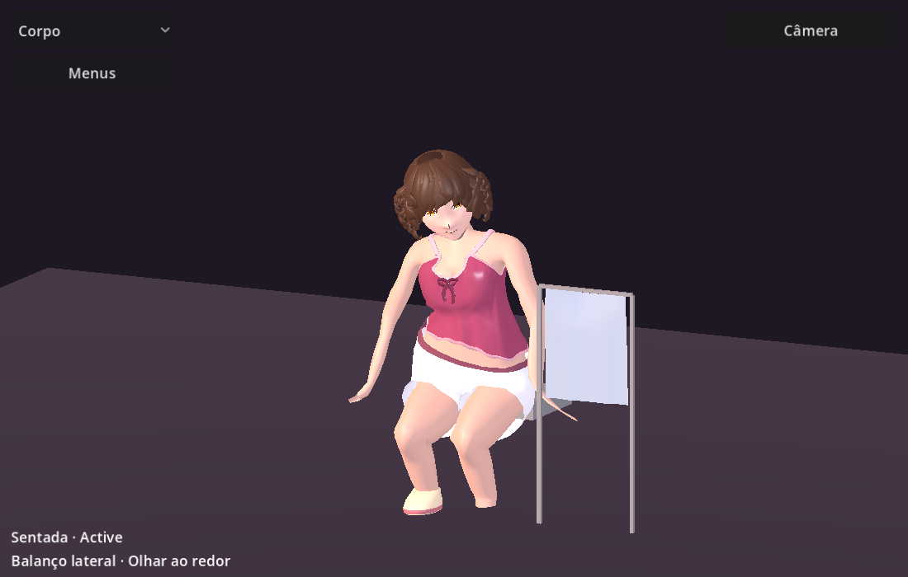
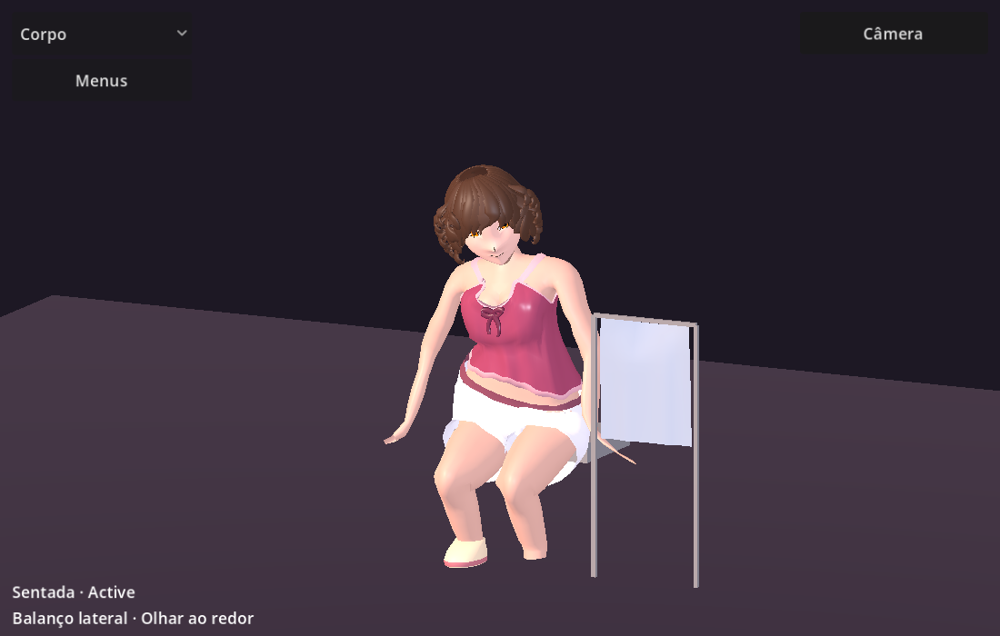

# ROSE 1.3.3.2.1 — Hotfix Cloth Response

Base: `74baca4b0520d7b99657a5fa99ddf416ba955928`. Branch: `rose/hotfix-cloth-response-1.3.3.2.1`.

## Diagnóstico

O solver calculava deslocamentos, mas a roupa recebia apenas uma parte pequena deles:

- O limite tangencial físico era 40% de uma faixa de 1,4% do comprimento da perna. Na reconstrução visual, a componente tangencial recebia outro fator de 15%: teto efetivo de 0,084% do comprimento da perna antes da interpolação.
- A identificação de bordas usava índices de vértices. Vértices duplicados pela autoria da malha podiam transformar uma aresta interna em duas bordas bloqueadas.
- O acoplamento ao skinning tinha um limite de distância, mas nenhuma restauração elástica dentro da faixa: parte das partículas permanecia encostada no limite sob gravidade, com pouca variação secundária.
- A conversão do deslocamento mundial para o espaço da malha removia o componente de escala/cisalhamento do skinning misto ao usar apenas a base ortonormalizada.

Não foi encontrado um AnimationPlayer sobrescrevendo a malha nova. O skinning continua sendo a referência principal, e somente `worn_layer.gd` escreve os deslocamentos secundários da roupa.

## Correção

A camada vestida mantém o solver XPBD existente e acrescenta restauração elástica proporcional ao erro entre alvo skinned e partícula. A faixa secundária passa a 2,8% do comprimento de perna, com limite total nessa faixa, componente tangencial de até 75% e transferência tangencial visual de 80%. Não há ondas predefinidas ou amplificação independente das posições simuladas.

A transferência usa a inversa da base linear de skinning quando ela é invertível. A identificação de arestas compara posições coincidentes, e vértices duplicados compartilham o deslocamento final. Bordas abertas reais continuam ajustadas à pose skinned. Uma costura coincidente bloqueada em uma superfície permanece bloqueada nas suas cópias. Grupos de costura e suas direções são preparados uma vez na montagem, evitando reconstruir essa busca a cada quadro.

Materiais, texturas, UVs, pesos, índices e blend shapes permanecem no mesmo caminho de renderização. Normais acompanham a deformação. A transferência evita deslocamento normal para dentro da superfície original e mantém o limite de movimento secundário. Isso preserva o ajuste nas bordas, mas não equivale a garantia universal de ausência de interpenetração em qualquer pose.

`cloth/controller.gd`, `cloth/xpbd.gd`, `cloth/accessory.gd`, os parâmetros musculares, o Active Ragdoll e o Action Composer foram preservados byte a byte em relação ao pacote base. Portanto, o pano independente continua com a mesma simulação, interações e presets.

## Uso no Android

Extraia o ZIP inteiro em uma pasta nova e execute `project.godot`. Nenhum controle novo precisa ser ligado: a resposta aprimorada das roupas atua durante as ações e mudanças posturais. Compare Sentada + Balanço + Olhar e depois Caminhada. Observe a região central da blusa, dobras e bolsos; alças, barra e cós permanecem ajustados nas bordas.

O modo Econômico continua sendo o padrão no Android sem preferência salva. O hotfix mantém 79 partículas físicas para a roupa e a atualização visual em até 15 Hz nesse modo; não aumenta a frequência da física ou a resolução do tecido. O movimento continua limitado e não permite retirar roupas. O teste em um aparelho Android físico depende de validação manual.

## Comparação reproduzível

O teste `tests/worn_response_test.gd` executa as mesmas bases (Em pé, Sentada, Caminhada) e ações (Balanço e Olhar, quando compatíveis), na qualidade Econômico. Amostra a cada oito passos durante 720 passos e mede diretamente `ARRAY_VERTEX` após reconstruir a malha. O RMS inclui todos os vértices amostrados, inclusive os imóveis. Não usa apenas o erro das partículas como indicador de movimento visível.

Os resultados finais estão abaixo e nos logs em `validation_cloth_hotfix/`. As capturas em `visual/` comparam o mesmo enquadramento e roteiro em OpenGL Compatibility/X11/Mesa no Linux. São capturas de execução real, não imagens geradas.

| Medida na malha visual | Base anterior | Hotfix |
| --- | ---: | ---: |
| Pico de deslocamento | 12,512 mm | 23,404 mm |
| RMS de deslocamento | 2,392 mm | 8,802 mm |
| Maior variação entre amostras | 12,516 mm | 34,480 mm |

O RMS da malha ficou aproximadamente 3,7 vezes maior no ensaio. Isso é uma medida da transferência, não uma promessa de amplitude em todas as peças ou poses. O teste exige pico acima de 18 mm, RMS acima de 5 mm e diferença menor que 1 mm entre deslocamentos de vértices coincidentes; a diferença final medida foi zero.

A reconstrução visual tem custo adicional para sincronizar costuras. No ensaio comparável ela passou de aproximadamente 6 ms por reconstrução para a faixa de 7–9 ms neste host. A atualização visual no Econômico continua limitada a 15 Hz. Os tempos completos por qualidade constam de `cloth_cost_test.log`; não representam desempenho de um aparelho Android. Não houve aumento de resolução física nem alteração das iterações.

## Validação

A auditoria de sintaxe/indentação verifica 93 scripts GDScript. A suíte tem os 30 testes anteriores mais `worn_response_test.gd`, que mede vértices renderizados e continuidade das costuras. O runner `python3 tools/validate_gameplay.py` importa, audita e executa os testes em diretório de dados temporário. Os resultados finais e códigos de aprovação estão em `validation_cloth_hotfix/results.json` e `syntax.json`.

Foram comparadas capturas reais em pé, sentada e caminhando. A blusa e os bolsos respondem mais ao movimento; o modelo conserva suas limitações anteriores de contato e dobras. O pano independente não foi recalibrado. A preservação byte a byte dos módulos citados foi conferida contra o ZIP base.

No Android, faça o mesmo roteiro em Econômico, com Sentada + Balanço + Olhar e depois Caminhada. Observe as peças durante o movimento e as transições, não só uma pose parada. Confira cobertura, bordas, contato com o banco e custo em Visualização. Teste em dispositivo Android físico **não foi executado** nesta entrega. Capturas e medidas foram obtidas no Godot 4.7.2/Linux, com renderer Compatibility/Mesa para revisão visual e headless para regressões.
