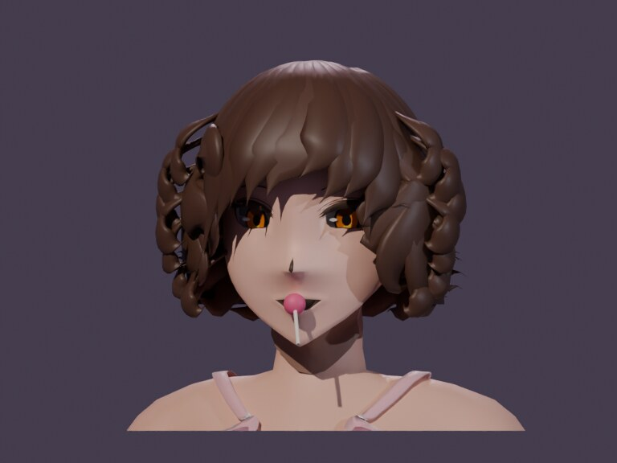

# Rosé no Godot · interação com o pirulito

O projeto usa o rosto, os olhos, os brilhos e o cabelo de `Rose_Clipe_Facial.blend`. A boca responde à distância do pirulito e o objeto, quando encaixado, acompanha o giro da personagem. O arquivo `assets/rose_portrait.glb` já vem pronto para o Godot.

## 1 · Abrir e experimentar

1. Extraia o ZIP. Abra o **Godot 4** no computador e, no gerenciador de projetos, clique em **Importar**. Selecione o `project.godot` da pasta extraída.
2. Abra o projeto, aguarde a importação do retrato e pressione **F5**. O projeto foi testado no Godot 4.7.2 com o renderizador Compatibility.
3. Segure o pirulito à direita e arraste até a boca. Fora do alcance, a boca fica fechada. Perto dos lábios, ela começa a abrir. Quando aparecer o indicador de encaixe, solte.
4. Com o pirulito encaixado, arraste com o botão direito para girar a Rosé. O pirulito deve acompanhar a boca.
5. Pegue o pirulito de novo e solte fora do indicador. Ele volta à posição inicial e a boca fecha.



*Referência do encaixe, renderizada no Blender a partir da malha exportada.*

O botão **Oferecer pirulito** e a tecla **Espaço** alternam entre oferecer e retirar. Use **R** ou **Esc** para reiniciar a demonstração.

## 2 · Ajustar o encaixe e a reação

Abra `demo.tscn`. Selecione `Rose → MouthAnchor` na árvore da cena. Em **Inspector → Transform → Position**, ajuste um eixo de cada vez e teste com **F5**.

| Ajuste | Onde | Efeito |
|---|---|---|
| X | `MouthAnchor` | Desloca o encaixe para a esquerda ou direita do rosto |
| Y | `MouthAnchor` | Sobe ou desce o objeto em relação aos lábios |
| Z | `MouthAnchor` | Aumentar Z traz o objeto para fora da boca no retrato inicial |
| `Snap Radius` | Nó raiz `RoseDemo` | Distância máxima para aceitar o objeto ao soltar |
| `Reaction Radius` | Nó raiz `RoseDemo` | Distância a partir da qual a boca começa a reagir |
| `Mouth Speed` | Nó raiz `RoseDemo` | Velocidade da abertura e do fechamento |

Altere a posição em incrementos de `0,01` unidade. Confira de frente e com o rosto girado. Use `Reaction Radius` maior que `Snap Radius` para manter a abertura gradual antes do encaixe. Os valores iniciais são `0,45` para reação e `0,12` para encaixe.

Em `interaction.gd`, `drag_to()` converte o cursor em um ponto no plano da boca. `finish_drag()` decide se o objeto encaixa ou retorna. `_follow_mouth()` aplica a transformação de `MouthAnchor` ao pirulito, com uma inclinação para deixar a haste à vista. O movimento da boca vem da blend shape `mouth_open`, atualizada em `_process()`. A piscada usa as mesmas intensidades em quatro malhas, entre rosto, olhos e brilhos.

## 3 · Reaproveitar o mecanismo

**Trocar o objeto.** Em `demo.tscn`, selecione `Lollipop` e substitua os filhos `Candy` e `Stick` pelas malhas de outro objeto pequeno, como uma colher. Preserve o nó `Lollipop` e coloque a ponta que toca os lábios na origem dele. Ajuste o ângulo em `_follow_mouth()`. Se o novo objeto tiver outro comprimento, ajuste o ponto final e a tolerância de seleção em `_hits_lollipop()`. Renomeie o objeto nos textos do HUD e repita o teste do tutorial 1.

**Usar a mesma lógica com um rig de cabeça.** No retrato atual, `MouthAnchor` fica sob `Rose`, então se move junto com ela. Em um modelo com um osso de cabeça animado, adicione um `BoneAttachment3D` sob o `Skeleton3D`, selecione o osso da cabeça, mova o `MouthAnchor` para baixo desse nó e atualize o caminho de `anchor` e `cue` no script. Confira o alinhamento com o osso em mais de uma pose.

**Atualizar o retrato a partir do Blender.** Extraia os dois `.blend` de `Rose_Clipe_Facial.zip` na mesma pasta. No Blender 5.1, o script `tools/export_rose.py` exporta o retrato e dá nomes estáveis às shape keys usadas no projeto. Com o Blender disponível no terminal, substitua os caminhos do comando abaixo. Feche o Godot ou deixe o editor reimportar o GLB após a exportação.

```bash
blender -b "/caminho/Rose_Clipe_Facial.blend" --python-exit-code 2 -P "/caminho/Rose_Godot/tools/export_rose.py" -- "/caminho/Rose_Godot/assets/rose_portrait.glb"
```

Se mudar nomes de objetos ou expressões no Blender, atualize `PARTS` ou `MORPHS` no script. Se mudar a posição da cabeça na cena de origem, calibre novamente `MouthAnchor`.

## Verificação automatizada

No terminal, dentro da pasta do projeto e com o Godot acessível pelo comando `godot`:

```bash
godot --headless --editor --import --quit
godot --headless -s res://tests/interaction_test.gd
```

O teste envia eventos de mouse à cena e verifica a abertura gradual da boca, a aceitação do encaixe, o acompanhamento durante o giro, a retirada e a sincronização da piscada entre as quatro malhas.
